<div align="center">

# XRViz

### Mixed-reality visualisation and teleoperation for ROS 2 robots, on Meta Quest 3.

See your robot, its sensors and its TF tree standing in the room with it — then move,
rebind and calibrate all of it from inside the headset, without touching the desktop.

[](https://github.com/tonydle/XRViz/releases/tag/V1.0.0)
[](ProjectSettings/ProjectVersion.txt)
[](https://github.com/Unity-Technologies/ROS-TCP-Connector)
[](https://www.meta.com/quest/quest-3/)
[](https://www.khronos.org/openxr/)

</div>

---

## What XRViz is

XRViz is a Unity 6 application that puts a ROS 2 robot's live state **into the room with the
robot**. It connects to a `ros_tcp_endpoint` over the network, renders the URDF model driven by
`/joint_states`, draws sensor topics — laser scans, RGBD and `PointCloud2` clouds, camera
images, markers, IMU — in passthrough mixed reality, and places all of it against the real
world either by hand or from `/tf`.

Everything is operated **from inside the headset** through one world-space control panel: no
keyboard, no re-deploy, no Editor round trip. It runs on a **Windows desktop over Quest Link**
or as a **standalone Quest 3 APK** (`com.UTS.XRViz`), from the same codebase.

## Highlights

| Capability | What it does |
|---|---|
| **Live robot mirroring** | URDF robots driven kinematically from `/joint_states`, mimic joints included |
| **Sensor visualisation** | Laser scan, RGBD point cloud, raw `PointCloud2`, camera windows, markers, IMU |
| **In-headset control panel** | Connect, browse topics, rebind subscribers, spawn extra views, show/hide, reset |
| **TF-accurate placement** | One fixed-frame origin, per-object `/tf` anchors that *report* failure instead of silently drawing at zero |
| **ArUco calibration** | Point the headset at a printed chassis tag to snap the TF world onto the real robot |
| **Teleoperation** | Publish twist, joint trajectory, pose and headset/controller tracking back to ROS |

---

## Features

### Mirror the real robot

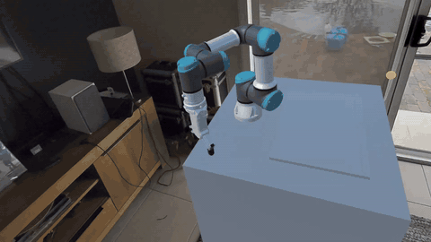

The URDF model is driven straight from `/joint_states`, gripper mimic joints included, so the
virtual arm moves with the real one through a whole task — and keeps doing so wherever you
walk around it.

### Sensors in the room

<table>
  <tr>
    <td width="50%">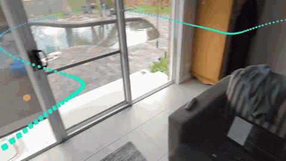</td>
    <td width="50%">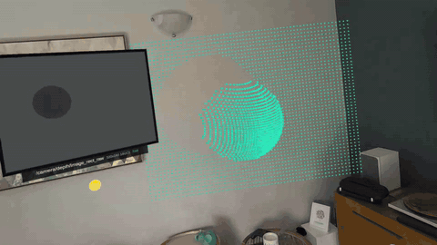</td>
  </tr>
  <tr>
    <td align="center"><b>LaserScan</b> — coloured by range, at the sensor's real height</td>
    <td align="center"><b>RGBD point cloud + camera image</b></td>
  </tr>
</table>

The RGBD cloud is reconstructed from the camera's own depth, so it lands on the real geometry
it was measured from:

<table>
  <tr>
    <td width="50%">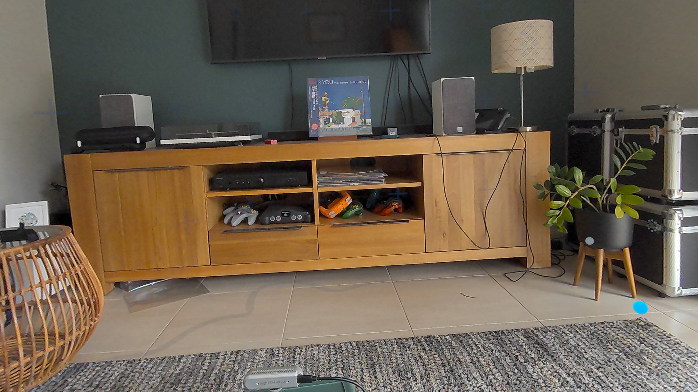</td>
    <td width="50%">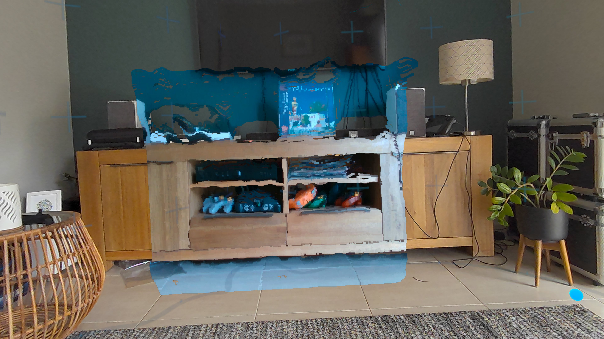</td>
  </tr>
  <tr>
    <td align="center">Real room (passthrough)</td>
    <td align="center">With the RGBd Camera cloud</td>
  </tr>
</table>

- **LaserScan** — drawn at the sensor's real height, coloured by range.
- **RGBD point cloud** — raw colour + depth `Image` plus `CameraInfo`, reconstructed in a
  compute shader and drawn as GPU billboards.
- **`PointCloud2`** — for lidar or pre-fused clouds: decimated before parsing, non-finite
  points dropped, optical and FLU frames handled correctly.
- **Camera windows** — floating image panels, with orientation and `bgr8`/`mono8` corrected
  from the encoding the message reports.
- **Markers and IMU** — cubes, cube lists and line strips; an IMU orientation visualiser.

### Connect from the headset

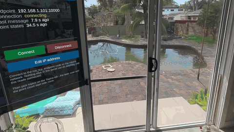

Type the endpoint's IP on the panel's on-screen keypad and press Connect — no rebuild to point
XRViz at a different ROS machine. It never connects on its own, and the header shows the
connection state the whole time.

The panel has a rail of tabs — **ROS · Topics · Views · TF · Scene · Calibrate · Guide** — and
hides on the left controller's Menu button. Summon it from somewhere it can't be seen and it
comes back to you.

### Many topics, many views

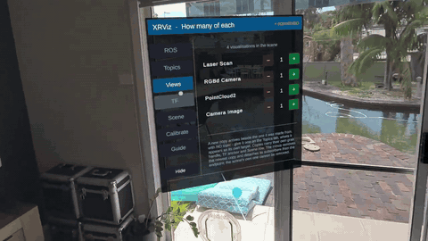

The **Topics** page lists what the endpoint actually advertises, filtered to the message types
each visualiser accepts, and rebinds the subscriber live. The **Views** page adds and removes
copies of any visualisation at runtime, each on its own topic with its own grab handle and TF
anchor — two camera feeds, two scans, two clouds, side by side. Two subscribers can share one
topic without interfering.

### Stale data never looks live

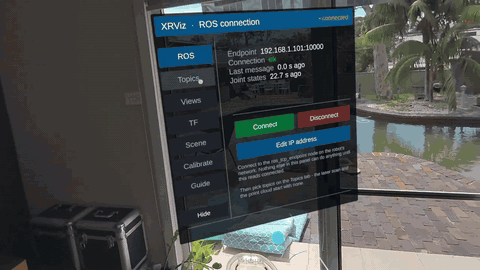

A frozen frame looks exactly like a live one — the most misleading thing to show next to a real
robot. Scans, clouds and camera windows clear themselves a few seconds after their last message,
and the panel's **Clear Data** button wipes everything on demand.

### Place it by hand, or from TF

Every object carries a colour-coded grab sphere (the panel shows the key) and a `TfAnchor` that
can take its pose from `/tf` instead. A single fixed-frame origin anchors the whole TF world to
the room; a card beside it names that frame, says whether `/tf` is live, and counts how many
anchors resolved. An unknown or stale frame is reported as a failure rather than drawn at the
origin.

### Calibrate against the real robot

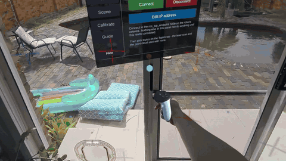

Stick a printed ArUco tag on the chassis and look at it: XRViz detects it through the
passthrough camera, solves its pose and snaps the TF origin so the virtual world lands on the
physical robot — search → confirm → apply, with a thumbstick height trim and Cancel.
Self-contained (no OpenCV, no native plugin); **headset APK only**.
Guide: [Docs/ARUCO_CALIBRATION.md](Docs/ARUCO_CALIBRATION.md).

For a tag-free alternative, the **MR robot registration tool** aligns the robot from matching
points placed by hand, and works over Quest Link too.

### Talk back to ROS

Grab the end effector or push a thumbstick to publish `Twist`/`TwistStamped`,
`JointTrajectory`, `PoseStamped`, `Joy` and more. Headset and controller tracking can be
streamed out as ROS topics for recording or shared autonomy.

### Supported robots

<table>
  <tr>
    <td width="50%" align="center"><br><b>UR3e + RG2</b></td>
    <td width="50%" align="center">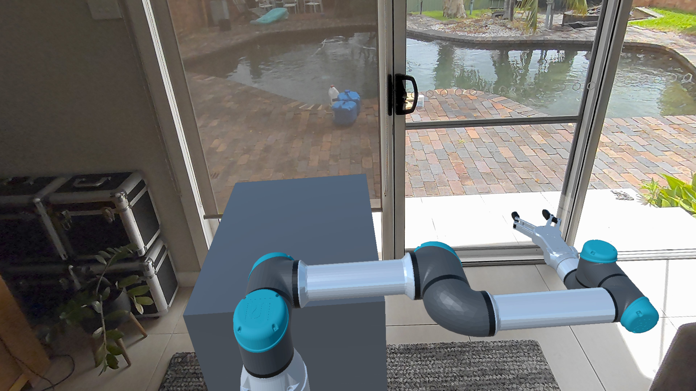<br><b>UR5e + RG6</b></td>
  </tr>
  <tr>
    <td align="center">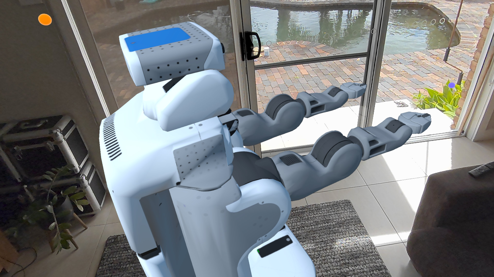<br><b>PR2</b></td>
    <td align="center">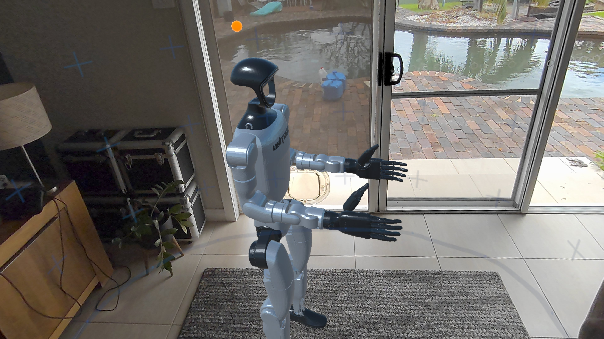<br><b>Unitree G1</b></td>
  </tr>
</table>

Pick the robot from the headset — the **Views** tab's top row (◄ ►) swaps it in place, keeping
its placement. One robot is shown at a time, and its topics are namespaced to its URDF name, so
the UR3e listens on `/ur3e_rg2/joint_states`. Every robot comes wired to joint states, gripper
mimic joints included. A RealSense D435 ships as a prefab too.

---

## Getting started

Full walkthrough with troubleshooting: [Docs/MVP_QUEST3_SETUP.md](Docs/MVP_QUEST3_SETUP.md).

### Prerequisites

- Unity **6000.3.11f1**
- A ROS 2 machine on the same network as the headset/desktop
- Meta Quest 3 (+ the **Meta Quest Link** desktop app to run on Windows)

### 1. Unity (one-time)

1. Open the project — the Meta XR SDK packages (`com.meta.xr.sdk.core`,
   `com.meta.xr.sdk.interaction.ovr` 203.0.0) resolve automatically.
2. Run **Meta > Tools > Project Setup Tool → Fix All** for your target
   (Windows and/or Android).
3. Run **XRViz > Create MR MVP Scene (UR3e)** — generates the main scene
   `Assets/XRViz/Scenes/MVP_UR3e_MR.unity` and adds it to Build Settings. Re-running it
   later only updates the objects it generates.
4. From **Meta > Tools > Building Blocks**, add to the scene:
   **[Camera Rig]**, **[Passthrough]**, **[Grab Interaction]** (placement handles),
   **[Ray Interaction]** (panel buttons — point + trigger), and optionally
   **[Hand Tracking]**. This step is one-time; re-generating the scene leaves them alone.
5. Optionally set a default **ROS IP Address** on `Assets/Resources/ROSConnectionPrefab`
   (port 10000) — or just type it on the panel's keypad at runtime.

### 2. ROS 2

```bash
# TCP endpoint (build ROS-TCP-Endpoint, branch main-ros2, into your workspace first)
ros2 run ros_tcp_endpoint default_server_endpoint --ros-args -p ROS_IP:=0.0.0.0 -p ROS_TCP_PORT:=10000

# UR3e joint states — real robot:
ros2 launch ur_robot_driver ur_control.launch.py ur_type:=ur3e robot_ip:=<robot-ip> launch_rviz:=false
# …or without hardware:
ros2 launch ur_robot_driver ur_control.launch.py ur_type:=ur3e robot_ip:=0.0.0.0 use_mock_hardware:=true launch_rviz:=false
```

If the endpoint crashes when the Topics page opens, see
[Docs/ROS_ENDPOINT_TOPIC_LIST_FIX.md](Docs/ROS_ENDPOINT_TOPIC_LIST_FIX.md).

### 3a. Run on Windows (Quest Link)

1. In the Meta Quest Link app, set it as the **active OpenXR runtime**
   (Settings > General) and enable **Passthrough over Meta Quest Link**
   (Settings > Beta).
2. Connect the Quest 3 via Link cable or Air Link.
3. Press **Play** in the Unity Editor, or build and run a Windows player. If the Meta XR
   Simulator is active, deactivate it first (Meta > Meta XR Simulator) — it overrides the
   Link runtime.

The ArUco calibration is unavailable over Link (the headset camera permission doesn't exist
there); **XRViz > Check ArUco Detector** tests its maths from the desk.

### 3b. Run on the headset (APK)

File > Build Profiles > Android > **Build And Run** with the Quest 3 on USB
(developer mode enabled).

### What you should see

Your room in passthrough, the UR3e in front of you and the control panel. Press **Connect** —
XRViz never connects on its own — and the robot starts tracking `/joint_states`. If something's
off, check the panel's status line, then the
[troubleshooting table](Docs/MVP_QUEST3_SETUP.md#troubleshooting).

---

## Repository layout

| Path | What's in it |
|---|---|
| `Assets/XRViz/Scripts/ROS/` | `RosPublisher<T>`/`RosSubscriber<T>` bases, per-message-type wrappers, the `/tf` tree, and `MessageHandling/` scene behaviour |
| `Assets/XRViz/Scripts/UI/` | The control panel: tabs, topic browser, views, TF and visibility pages, keypad |
| `Assets/XRViz/Scripts/Interaction/` | `PlacementHandle` grab spheres and `TfAnchor` |
| `Assets/XRViz/Scripts/Calibration/` | ArUco detector, pose solver and calibration flow |
| `Assets/XRViz/Scripts/Editor/` | The **XRViz** menu — scene generation, joint-state wiring, tag export, detector self-check |
| `Assets/XRViz/Robots/` | URDF-imported robot prefabs |
| `Assets/XRViz/Shaders/` | Stereo-aware unlit shaders and the GPU point cloud compute shaders |
| `Assets/XRViz/MRRobotRegistrationTool/` | Tag-free manual alignment of the virtual robot to the real one |

## Documentation

| Document | Covers |
|---|---|
| [Docs/MVP_QUEST3_SETUP.md](Docs/MVP_QUEST3_SETUP.md) | Full setup, every panel page, every visualiser, troubleshooting |
| [Docs/ARUCO_CALIBRATION.md](Docs/ARUCO_CALIBRATION.md) | Printing, configuring and debugging the chassis-tag calibration |
| [Docs/ROS_ENDPOINT_TOPIC_LIST_FIX.md](Docs/ROS_ENDPOINT_TOPIC_LIST_FIX.md) | Patching the `ros_tcp_endpoint` topic-list crash |
| [CLAUDE.md](CLAUDE.md) | Architecture summary and the rules new code has to follow |

## License

See [LICENSE](LICENSE).
